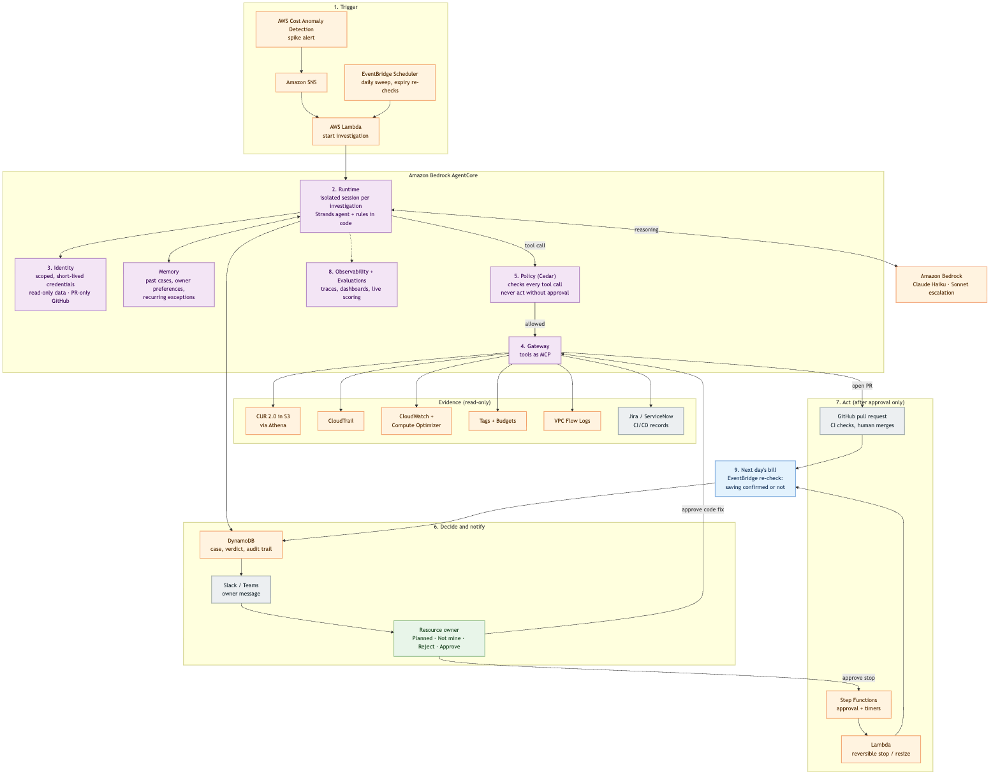

# AWS FinOps Agent - 25 Days of AI 
An Agent which checks whether AWS cost rise is due to usage and creates PR for fixes , Human review of the PR at the end

**Agentic FinOps on AWS: From Cost Spikes to Owner-Approved Remediation.** Every cost spike explained by the next
morning, with proof.

Code measures, AI investigates, humans judge:
1. **Detect (code).** AWS Cost Anomaly Detection flags the spike. Code checks it matters and splits it into drivers.
2. **Investigate (AI).** A Strands agent on Amazon Bedrock (Claude Haiku) uses read-only tools (CUR 2.0, CloudTrail,
   tags, tickets, budgets, exceptions, CloudWatch, deployments, flow logs). Every claim cites an evidence ID.
3. **Decide (code).** Four checks (size, timing, exact ID, owner), then verdict, money, routing. Invalid citations
   are rejected, retried, then escalated to Sonnet.
4. **Explain (AI, checked by code).** A plain-English write-up. Numbers and IDs are verified against code's facts.
5. **Owner inbox (human).** Planned / Not mine / Reject / Approve fix. Nothing happens without a click.
6. **Fix.** A simulated `ec2:StopInstances` for console-made GPUs, or a real pull request on the demo monorepo
   [`acme-platform`](https://github.com/Harisri-Sanjivan-S/acme-platform), written by Devin (CLI) or a fixed template.
   Code checks the changed files before pushing. A human merges.
7. **Confirm (code).** The next day's bill proves (or doesn't) the saving.

All AWS data is planted, shaped like the real services. The only AWS service used is Bedrock. No resources are created.

**Production path:** the same agent on Amazon Bedrock AgentCore (Runtime, Gateway, Identity, Policy, Memory,
Observability, Evaluations). See [docs/agentcore-production.md](docs/agentcore-production.md).



## Run it

```bash
uv sync
cp .env.example .env                      # non-secret settings; AWS keys stay in ~/.aws (profile finops-poc)
uv run streamlit run app/Home.py          # console, investigation, case, inbox, results
```

- **Acting as** (top of the sidebar) switches between actors. Each actor's role decides what they can see and do.
  The rules live in `detective/rbac.py` and are enforced in the pipeline as well as the UI.

  | Actor | Pages | Cases | Can act on |
  |---|---|---|---|
  | FinOps team | Console, Investigation, Case report, Inbox, Results and settings | all | own cases; re-route any case |
  | Ravi M., Priya S., Orders team, Platform team | Inbox, Case report | own | own cases only |
- Every investigation runs on **Amazon Bedrock (Claude)**. The console shows a cost estimate and asks for approval first.
  The scripted dry run is used only by the automated tests.
- **Demo week, 7–14 Nov 2026:** one cost story per day, picked on the console. Run the whole week at once with
  `uv run python scripts/run_week.py --confirm --owner-actions`, which prints the estimate first.

  | Day | Story | Verdict |
  |---|---|---|
  | Sat 7 | Noise only | Below the gate, no alert |
  | Sun 8 | Forgotten GPU notebooks (Anika) | Likely waste → stop → saving proven |
  | Mon 9 | Approved but idle rehearsal hosts (Priya) | Oversized → ask the owner |
  | Tue 10 | Forgotten GPUs + approved load test + NAT after deploy | Likely waste / Expected / Unbudgeted |
  | Wed 11 | Approved load test + NAT charge continues | Expected / Unbudgeted |
  | Thu 12 | Instances with no change event or tags | Unexplained → FinOps |
  | Fri 13 | GPUs with a prompt-injection ticket | Likely waste (injection ignored) |
  | Sat 14 | GPUs relaunched after the stop | Likely waste → saving **not** confirmed |
- **AI performance & proof** (FinOps team, Platform team):
  - accuracy, routing, valid citations, right-first-time, time, cost and tool calls per day;
  - proof of changes: next-day bill before/after, PR links with diffs, the decision audit trail.
- Demo flow, as FinOps: Console → **Investigate** → Case report. Then switch actor:
  - As Ravi M.: Inbox → **Approve stop**, then **Next day**.
  - As Orders team: Inbox → **Approve fix and open PR**.

## Commands

| What | Command |
|---|---|
| Tests (no AWS, no network) | `uv run pytest -q` |
| Lint | `uv run ruff check .` |
| Regenerate fixtures | `uv run python -m detective.fixturegen` |
| Eval harness, offline | `uv run python -m evals.run --mode offline --runs 1` |
| Eval on Bedrock (prints estimate; needs approval) | `uv run python -m evals.run --mode bedrock --runs 3 --confirm` |
| Naive baseline (prints estimate; needs approval) | `uv run python -m evals.baseline --runs 3 --confirm` |
| Reset demo (dry run by default) | `uv run python scripts/reset_demo.py --yes [--github]` |

## Cost guard
- Every Bedrock call goes into `runs/ledger.jsonl` and is shown in the sidebar.
- Warnings at $10 and $20. New calls are refused at **$25** unless `FINOPS_COST_OVERRIDE=1` is set.
- The project ceiling is $30.

## Layout
- `detective/`: the POC.
  - `detect.py` and `rules.py`: code decisions.
  - `tools.py`: read tools.
  - `agent.py`: Bedrock agents and offline doubles.
  - `pipeline.py`: orchestration and owner actions.
  - `fixers/`: fix brief, template and Devin executors.
  - `ledger.py`: cost guard.
- `app/`: Streamlit UI.
- `scenarios/`, `fixtures/`: planted data.
- `evals/`: answer keys (tests only), runner, baseline, results.
- `demo_repo/acme-platform/`: source of the demo monorepo.
- `docs/`: implementation plan, video script, diagrams.
