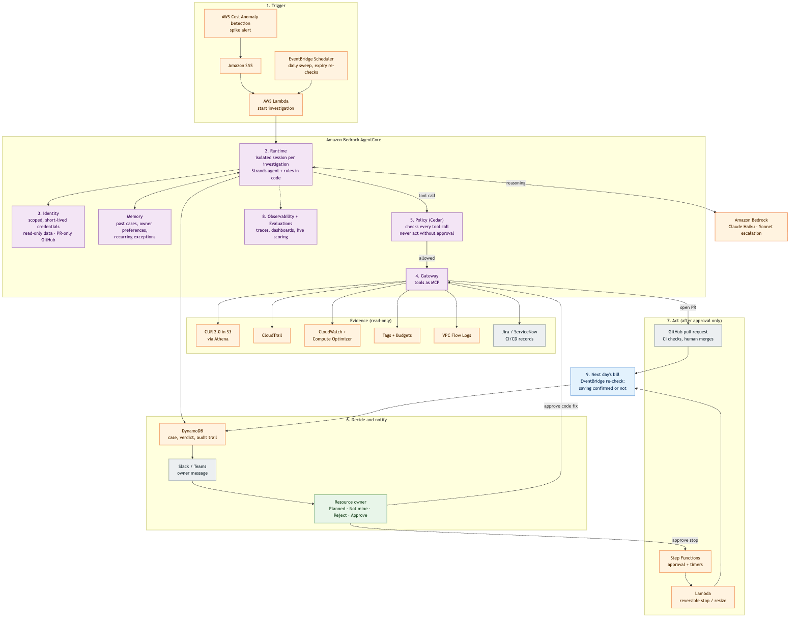

# Production workflow on Amazon Bedrock AgentCore

Reference for the video (shot 11) and for questions afterwards. The POC runs locally; this is how the same agent runs
in production, with everything inside the customer's AWS account.

Source: [`diagrams/agentcore-production.mmd`](diagrams/agentcore-production.mmd) (Mermaid).

## Step by step

| # | Step | Who does it | What happens |
|---|---|---|---|
| 1 | **Trigger** | Cost Anomaly Detection → SNS → Lambda; EventBridge Scheduler | A spike alert (or the daily sweep, or an exception reaching its expiry) starts an investigation |
| 2 | **Host the agent** | AgentCore **Runtime** | Opens an isolated session for this investigation and runs the Strands agent plus the rules in code; scales automatically |
| 3 | **Get credentials** | AgentCore **Identity** | Issues scoped, short-lived credentials: read-only for billing, CloudTrail and metrics; open-PR only for GitHub; no right to change resources |
| 4 | **Use tools** | AgentCore **Gateway** | Exposes live tools over MCP: CUR 2.0 via Athena, CloudTrail, CloudWatch and Compute Optimizer, tags and Budgets, VPC Flow Logs, Jira/ServiceNow, CI/CD records (AWS's official MCP servers where available) |
| 5 | **Check every call** | AgentCore **Policy** (Cedar) | Every tool call is checked before it runs, e.g. "may read billing", "may open PRs on infra repos", "may never stop a resource without an approval". Holds even if the model is tricked |
| — | **Reason** | Amazon **Bedrock** | Claude Haiku plans tool calls and writes the explanation; code escalates to Sonnet only when it rejects an answer |
| — | **Remember** | AgentCore **Memory** | Past investigations, owner preferences, recurring exceptions, so repeat spikes are explained faster |
| 6 | **Decide and notify** | Rules in code → DynamoDB → Slack/Teams | Code scores the four checks and sets the verdict and money; the case and audit trail are stored; the owner gets a message with Planned / Not mine / Reject / Approve |
| 7 | **Act (approval only)** | Step Functions + Lambda; Gateway → GitHub | Approve stop: Step Functions records the approval, then a narrowly scoped Lambda stops or resizes the resource (reversible). Approve code fix: a pull request is opened; CI checks it; a human merges |
| 8 | **Observe and grade** | AgentCore **Observability** + **Evaluations** | Every model call, tool call and decision is traced to CloudWatch; dashboards show investigations, false alarms, confirmed savings, tokens and cost; a sample of live investigations is scored for faithfulness and tool use |
| 9 | **Confirm** | EventBridge re-check | The next day's bill is compared with the expected saving; the case records "confirmed" or "not confirmed" |

## AgentCore services at a glance

| Service | Job in production | Replaces in the POC |
|---|---|---|
| Runtime | Hosts the agent, one isolated session per investigation | `uv run streamlit` on a laptop |
| Gateway | Live tools over MCP, authenticated | Sample data in AWS formats behind the same tool signatures |
| Identity | Scoped credentials per tool, across accounts | The `finops-poc` CLI profile and `gh` login |
| Policy | Hard rules on every tool call (Cedar) | Code-only guard: action tools never given to the agent |
| Memory | Past cases, preferences, exceptions | None (each run starts fresh) |
| Observability | Traces, dashboards, alarms in CloudWatch | Live tool trace in the UI and the local cost ledger |
| Evaluations | Live scoring of real investigations | `evals/run.py`: 7 scenarios × 3 runs |

## Why it matters (one line each)
- **Data stays in AWS:** bills, CloudTrail and model calls never leave the customer's account and network.
- **Least privilege:** the agent can read evidence and open PRs, and nothing else; actions need an approval.
- **Auditable:** every step is in CloudTrail and CloudWatch, and every case in DynamoDB.
- **Measurable:** the agent's own cost and quality are tracked like any other workload.
- **Small move from the POC:** the agent is UI-independent and the tools keep their signatures, so going live is a
  wrap (`@app.entrypoint`) and `agentcore deploy`, then swapping the data source behind each tool.

## Say it in the video (about 15 seconds)
> "In production, everything stays inside AWS. The alert comes from Cost Anomaly Detection, and the agent runs on Amazon
> Bedrock AgentCore: Gateway connects it to live billing and CloudTrail data, Identity and Policy guarantee it can never
> act without approval, and Observability records every step. Every cost spike explained by the next morning, with proof."

## Not built in the POC
AgentCore needs the AWS Paid plan (this account is on the Free plan) and adds usage costs. The POC proves the idea
locally; this workflow is the production path.
